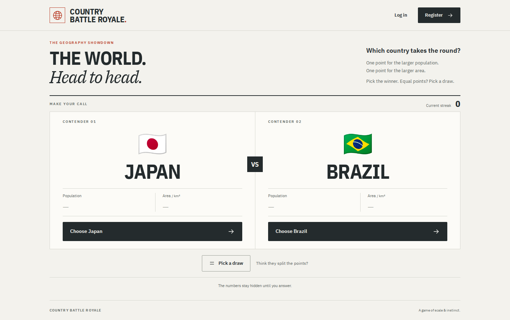
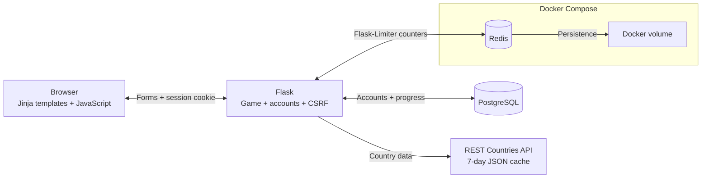

# Country Battle Royale

A geography game: two countries, one call. Pick the winner on population and area, build a streak, and save your progress with an account.

[](https://www.python.org/)
[](https://flask.palletsprojects.com/)
[](https://www.postgresql.org/)
[](https://redis.io/)
[](https://docs.docker.com/compose/)
[](https://developer.mozilla.org/en-US/docs/Web/JavaScript)



## How to play

- **Compare:** larger population and larger area each earn one point. Pick the winner or a draw.
- **Reveal:** statistics stay hidden until you answer. Correct guesses build your streak.
- **Return:** play as a guest, or register to save rounds played, wins, and your best streak.

## Architecture



PostgreSQL stores accounts and game progress. Redis stores temporary request-limit counters shared across Flask processes. Compose runs Redis with a health check and a persistent volume; Flask and PostgreSQL run separately.

## Request flows

Every POST form carries a session-linked CSRF token. Flask rejects missing or invalid tokens before the route runs. Login and registration also use Flask-Limiter with Redis to bound repeated attempts.

Limits are **30 login attempts per 15 minutes** and **10 registration attempts per hour**, each counted per IP. Successful and failed attempts both count.

| Action | Flow |
| --- | --- |
| Play | Get a country pair → submit a guess → reveal the result → update streak and account stats |
| Register | CSRF + rate-limit checks → Argon2 password hash → PostgreSQL account → login session |
| Log in | CSRF + rate-limit checks → look up account → verify Argon2 hash → login session |
| Log out | CSRF check → clear account login from the session → continue playing |

Session cookies keep the browser signed in. Redis counters stay on the server, so clearing browser cookies does not reset rate limits. Excess attempts receive `429 Too Many Requests`.

## Run locally

Requires **Python 3.12+**, **Docker Compose**, and **PostgreSQL** with the project's `users` table. From the project root:

```bash
python3 -m venv .venv
source .venv/bin/activate
python -m pip install -r requirements.txt
cp -n .env.example .env
```

Fill in `.env`:

| Variable | Value |
| --- | --- |
| `MY_SECRET_KEY` | REST Countries v5 API key |
| `FLASK_SECRET_KEY` | A random secret generated below |
| `DATABASE_URL` | PostgreSQL connection URL |

```bash
python -c "import secrets; print(secrets.token_hex(32))"
```

Paste the output into `FLASK_SECRET_KEY`. Keep `.env` out of Git.

<details>
<summary>Already running Redis as a Linux service?</summary>

Stop it and disable its automatic startup to free port `6379` for the container:

```bash
sudo systemctl disable --now redis-server
```

</details>

Start Redis, check for `PONG`, then start Flask:

```bash
docker compose up -d --wait redis
docker compose exec redis redis-cli ping
python -m flask --app backend.app run --debug
```

Open **[localhost:5000](http://127.0.0.1:5000)**. Redis is available at `redis://127.0.0.1:6379/0`; its port is bound to localhost. Stop it with `docker compose stop redis`; the data volume is retained.

Country data downloads need an internet connection and a valid API key when the cache is missing or older than seven days.

## Tests

```bash
python -m unittest tests -v
```

Start Redis before running tests; GitHub Actions starts its own Redis container. The country-comparison test uses the country cache and may need API access to refresh it.

---

[MIT license](LICENSE) · [Font license](static/fonts/arena-OFL.txt)
